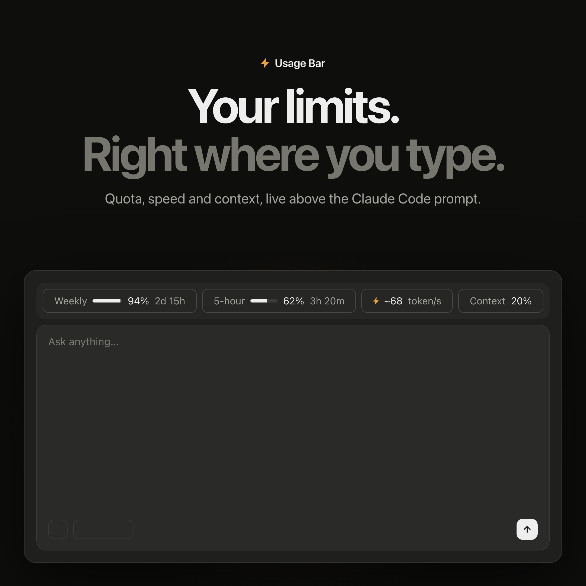
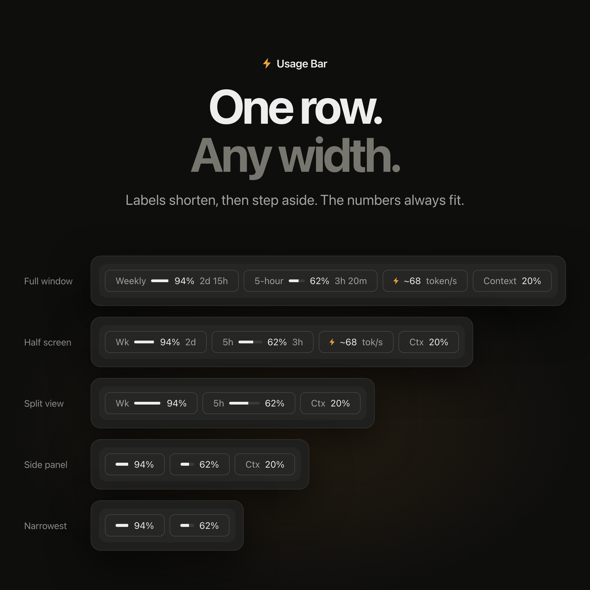

# Claude Usage Bar

See your weekly usage, your 5-hour usage (or credit, on Max), response speed and context just above the Claude prompt.

<p align="center">
  
  
</p>

**Weekly → 5-hour → Token speed → Context**

On Max: **Weekly → Context → Token speed → Credit**

The design is adopted from [codex-usage-bar](https://github.com/cocombee/codex-usage-bar); the wiring is new and uses Claude's own plugin API, so nothing in the app is patched or re-signed.

## What it shows

| Metric | Behavior |
| --- | --- |
| **Weekly** | 7-day limit remaining, as a percentage, with its track and reset countdown. |
| **5-hour** | 5-hour limit remaining, as a percentage, with its track and reset countdown. |
| **Credit** | On Max, last in the row, where Context sits on other plans: all the credit the account has, added up — promo credit (until it ends), Claude Code and Cowork credit, prepaid credit and bought usage credit — with its cents up to four digits (`$0.70`, `$37.60`) and in whole dollars with commas from $100 (`Credit $1,250`; `$0` with none). Label and amount only, as wide as they are; the amount turns yellow and red as what is left of its limits runs low. Context takes 5-hour's slot instead, with its track or ring and its sizes. A longer amount shortens both tracks alike, and where it no longer fits, the bar steps down a size. The plan is read from the account profile the app reads, so each person sees the one that applies to them; until it is known, this layout shows wherever no 5-hour window is reported. |
| **Token speed** | Approximate `~N token/s` while Claude replies: output tokens over model-response time for up to 10 responses in the turn, tool time excluded. Clears to `—` when the turn ends. |
| **Context** | How full the current chat's context window is. On Max it takes 5-hour's slot, and its track or ring fills with what is used. |

The two quota figures are the ones the Claude app's usage panel shows: read once a minute
(shared among open chats) and after each turn from the same usage endpoint, with the chat's
own sign-in. A reply's headers fill in between and when that read is unavailable; they can
run a point behind, so they never lower a figure the panel already gave for that window.

The two quota readings count **down** — they show what is left. Context counts **up**: it
shows how much of the window is used. So a good day is a high Weekly and a low Context.

Weekly's track and the second slot's track are always the same length: the row's spare width is split evenly between the two tracks, so the divider between them moves with the texts' lengths rather than the tracks.

The four readings sit in one open row with a thin divider between each, no box around
any of them; in a terminal that is a single line. Tracks and their figures turn yellow at
20% left or less and red at 10% or less; Context's figure does the same at 80% and 90% used. Missing data shows `—`, never a made-up zero. The bar has seven sizes, widest to narrowest, so it always stays one row:

| Size | From (desktop) | Shows |
| --- | --- | --- |
| XXL | 642pt | `Weekly ━━ 85% 5d 21h │ 5-hour ━━ 99% 4h 28m │ ⚡ ~89 token/s │ Context 33%` |
| XL | 543pt | `Wk ━━ 85% 5d 21h │ 5h ━━ 99% 4h 28m │ ⚡ ~89 tok/s │ Ctx 33%` |
| L | 459pt | `Wk ━━ 85% 5d │ 5h ━━ 99% 4h │ ⚡ ~89 tok/s │ Ctx 33%` |
| M | 410pt | `Wk ◔ 85% │ 5h ◔ 99% │ ⚡ ~89 t/s │ Ctx 33%` |
| S | where it fits | `Wk ◔ 85% │ 5h ◔ 99% │ Ctx 33%` |
| XS | where it fits | `Wk ◔ 85% │ 5h ◔ 99%` |
| XXS | below that | `◔ 85% │ ◔ 99%` |

A size is used from its breakpoint up to the next bigger size's, and only where its content fits with the bar's padding. On the desktop, M and below draw each quota as a small ring; the terminal draws tracks at every size. Usage limits appear on Claude subscription plans; elsewhere those readings show `—`.

## Install

Install it as a plugin for your user, so **every chat** gets it — in the terminal, the
desktop app and the IDEs alike:

```
claude plugin marketplace add cocombee/claude-usage-bar
claude plugin install usage-bar@cocombee
```

Or, inside a Claude Code terminal chat:

```
/plugin install usage-bar --marketplace cocombee/claude-usage-bar
```

`claude plugin list` should then show `usage-bar@cocombee` with `Scope: user` and
`Status: ✔ enabled`. It loads in every new chat; reopen chats that were already open
(or run `/reload-plugins` in them) to pick it up. On Windows with the desktop app,
`claude` may not be on your PATH: the app keeps its copy under
`%LOCALAPPDATA%\Claude-Data\claude_<id>\claude-code\<version>\…\claude.exe`.

Do not copy the folder into a chat's mods folder (`~/.claude/dev-mods/<session>/`):
a mod there loads in that one chat only, never in any other.

Installed from a folder, the plugin is read from that folder rather than copied, so edits
there reach a chat at its next start or on `/reload-plugins` — a chat already running keeps
the code it loaded.

## Development

```sh
claude plugin validate .
claude plugin test .
```

`validate` prints the engine calls it found in `register.tsx`; that list is the quickest
check that a hook is wired as intended, and that nothing writes to disk.

### Writing tests

Both surfaces draw the readings as Boxes of `Text`; on the desktop each quota
reading's track and each divider is a small `<Svg>` with no words in it. Read what the bar shows through
`tests/shown.ts`, which collects the `Text` nodes and any `<text>` drawn inside an
SVG, so a test keeps seeing the words even if a later drawing moves them into one:

```ts
import { shown, exactly, like } from './shown'

const words = await shown(ui)   // every string the bar drew
exactly(words, '15%')           // whole-item match
like(words, '5-hour')           // substring match
```

Pick a mount width inside the size you mean to test: with no measurement yet every
figure is `—`, which is narrower than real figures, so the same width can land on a
fuller size than it would with data.

## License

MIT. Not an official Anthropic plugin.
