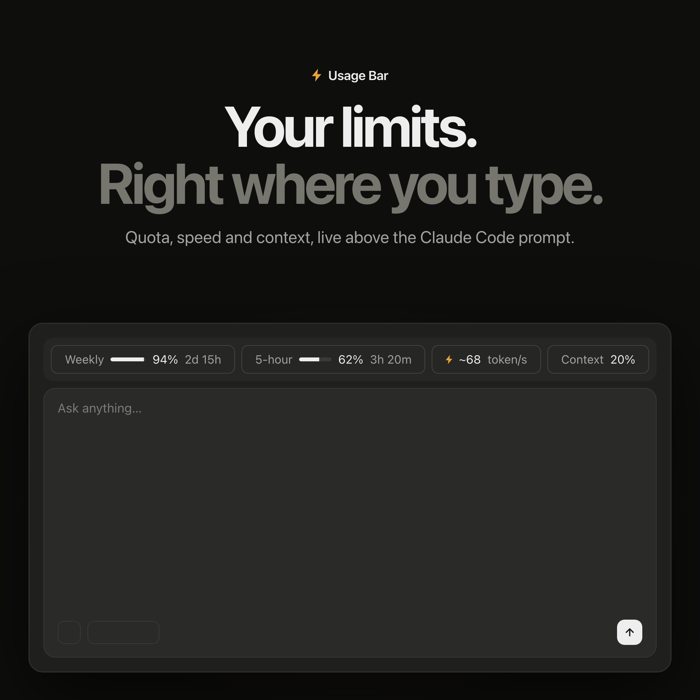
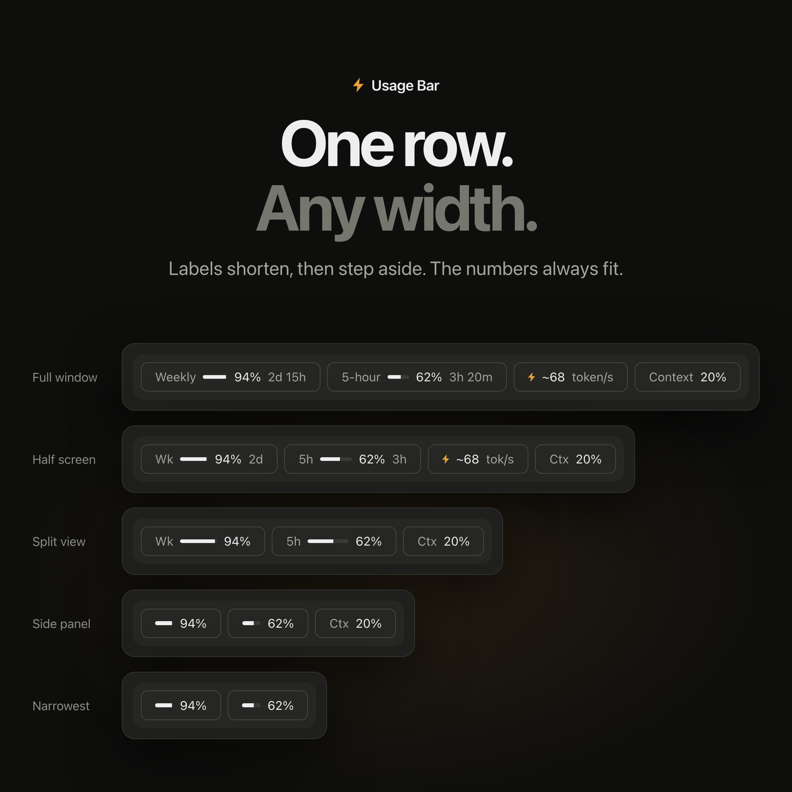

# Claude Usage Bar

See your 5-hour usage, weekly usage, response speed and context just above the Claude prompt.

<p align="center">
  
  
</p>

**Weekly → 5-hour → Token speed → Context**

The design is adopted from [codex-usage-bar](https://github.com/cocombee/codex-usage-bar); the wiring is new and uses Claude's own plugin API, so nothing in the app is patched or re-signed.

## What it shows

| Metric | Behavior |
| --- | --- |
| **Weekly** | 7-day limit remaining, as a percentage, with its track and reset countdown. |
| **5-hour** | 5-hour limit remaining, as a percentage, with its track and reset countdown. |
| **Token speed** | Approximate `~N token/s` while Claude replies: output tokens over model-response time for up to 10 responses in the turn, tool time excluded. Clears to `—` when the turn ends. |
| **Context** | How full the current chat's context window is. |

The two quota pills count **down** — they show what is left. Context counts **up**: it
shows how much of the window is used. So a good day is a high Weekly and a low Context.

Tracks turn yellow at 20% left or less and red at 10% or less. Missing data shows `—`, never a made-up zero. Narrow windows shorten labels (Wk, 5h, Ctx, tok/s) so the bar stays one row. Usage limits appear on Claude subscription plans; elsewhere those pills show `—`.

## Install

```
/plugin install usage-bar --marketplace cocombee/claude-usage-bar
```

Once installed it loads in every new chat. Reopen chats that were already open to pick it up.

Installed from a folder, the plugin is read from that folder rather than copied, so edits
there reach a chat at its next start or on `/reload-plugins` — a chat already running keeps
the code it loaded.

## Development

```sh
claude plugin validate .
claude plugin test .
```

`validate` prints the engine calls it found in `register.tsx`; that list is the quickest
check that a hook is wired as intended, and that nothing writes to disk.

### Writing tests

Both surfaces draw the pills as Boxes of `Text`; on the desktop each quota pill's
track is a small `<Svg>` with no words in it. Read what the bar shows through
`tests/shown.ts`, which collects the `Text` nodes and any `<text>` drawn inside an
SVG, so a test keeps seeing the words even if a later drawing moves them into one:

```ts
import { shown, exactly, like } from './shown'

const words = await shown(ui)   // every string the bar drew
exactly(words, '15%')           // whole-item match
like(words, '5-hour')           // substring match
```

Pick a mount width inside the size you mean to test: with no measurement yet every
figure is `—`, which is narrower than real figures, so the same width can land on a
fuller size than it would with data.

## License

MIT. Not an official Anthropic plugin.
